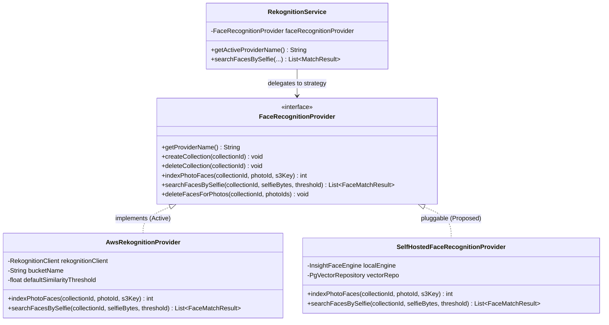
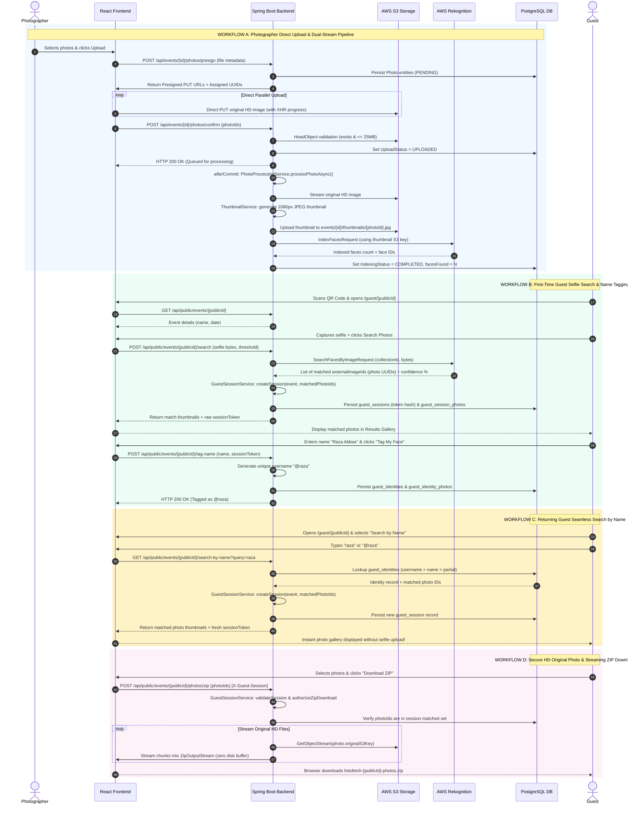

# FotoFetch AI — System Architecture Specification & Technical Notes

---

## Academic Project Identification

- **Project Title:** FotoFetch AI — Cloud-Based Multi-Tenant AI Platform for Event Facial Recognition & Intelligent Photo Retrieval
- **Institution:** Department of Software Engineering, Mehran University of Engineering, Science & Technology (MUET), Jamshoro
- **Batch:** 23SW
- **Project Members:**
  1. Syed Raza Abbas (Roll No: 23SW069)
  2. Member 2 (Roll No: 23SW014)
  3. Member 3 (Roll No: 23SW160)
- **Academic Supervisor:** Ma'am Soonh Taj (Assistant Professor, Department of Software Engineering, MUET)
- **Industrial Co-Supervisor:** Syed Jari Abbas (Software Engineer, Habib Metropolitan Bank)
- **United Nations Sustainable Development Goals (SDGs):**
  - **SDG 9:** Industry, Innovation, and Infrastructure (modernizing digital media asset management via cloud AI and multi-tenant SaaS architecture).
  - **SDG 11:** Sustainable Cities and Communities (streamlining social and community event experiences through automated, paperless, instant photo distribution).

---

## 1. Executive Summary & Architectural Overview

FotoFetch AI is an enterprise-grade, multi-tenant Software-as-a-Service (SaaS) platform architected to eliminate the manual, friction-heavy process of browsing thousands of event photos. Traditional event photo distribution relies on shared cloud storage links, social media groups, or USB drives, forcing guests to scroll through massive unindexed galleries. FotoFetch AI solves this by coupling **cloud-based facial recognition** with a **scalable, multi-tenant cloud storage and asynchronous processing architecture**.

The system operates across two primary operational surfaces:
1. **Authenticated Studio & Event Management Surface:** Enables photography studios and photographers to provision events, generate dynamic guest access QR codes, and upload full-resolution high-definition (HD) photos directly to cloud object storage.
2. **Account-Free Public Guest Discovery Surface:** Empowers event attendees to access their personalized photos instantaneously using a single selfie without requiring account registration, while persistently tagging matching images with their name for seamless text-based retrieval on repeat visits.

### High-Level Architecture Diagram References
The system architecture has been authored in three deliverable formats within the documentation directory:
- **Mermaid Source Definition:** [`docs/architecture/fotofetch-overall-architecture.mmd`](file:///c:/Users/IQRA%20COMPUTER/Desktop/fyp%201/docs/architecture/fotofetch-overall-architecture.mmd)
- **Vector Graphic (SVG):** [`docs/architecture/fotofetch-overall-architecture.svg`](file:///c:/Users/IQRA%20COMPUTER/Desktop/fyp%201/docs/architecture/fotofetch-overall-architecture.svg)
- **High-Resolution Presentation Raster (PNG):** [`docs/architecture/fotofetch-overall-architecture.png`](file:///c:/Users/IQRA%20COMPUTER/Desktop/fyp%201/docs/architecture/fotofetch-overall-architecture.png)

---

## 2. Comprehensive Layer-by-Layer Architecture

The FotoFetch AI platform is organized into six distinct architectural layers, ensuring separation of concerns, scalability, fault tolerance, and security.

```
+-----------------------------------------------------------------------------------+
| LAYER 1: USER & ACCESS LAYER (5 Roles & Security Boundaries)                      |
+-----------------------------------------------------------------------------------+
                                         |
                                         v
+-----------------------------------------------------------------------------------+
| LAYER 2: FRONTEND / PRESENTATION LAYER (React.js SPA, Vite, Tailwind CSS)         |
+-----------------------------------------------------------------------------------+
             | (Direct Presigned Upload)              | (REST API / JWT)
             v                                        v
+-----------------------------------------------------------------------------------+
| LAYER 3: BACKEND APPLICATION LAYER (Spring Boot 3, Java 17/21, Spring Async)       |
+-----------------------------------------------------------------------------------+
             |                                        |
             v                                        v
+------------------------------------+  +-------------------------------------------+
| LAYER 4: AI & FACE RECOGNITION     |  | LAYER 5: DUAL-STREAM PHOTO PIPELINE       |
| (Strategy Pattern / Rekognition)   |  | (Stream A: Thumbnails / Stream B: HD)     |
+------------------------------------+  +-------------------------------------------+
             |                                        |
             +-------------------+--------------------+
                                 |
                                 v
+-----------------------------------------------------------------------------------+
| LAYER 6: CLOUD INFRASTRUCTURE & STORAGE (AWS S3, PostgreSQL 15, Rekognition Colls)|
+-----------------------------------------------------------------------------------+
```

---

### Layer 1: User & Access Layer

The system defines five distinct user roles across two operational trust boundaries:

| Role Name | Trust Boundary | Authentication Mechanism | Primary Responsibilities | Implementation Status |
| :--- | :--- | :--- | :--- | :--- |
| **Super Admin** | Authenticated Studio Boundary | Stateless JWT Bearer Token | Platform oversight, cross-studio provisioning, billing quota management, audit logs. | **Proposed** |
| **Studio Admin** | Authenticated Studio Boundary | Stateless JWT Bearer Token | Photography studio governance, team management, prepaid billing wallet funding, event auditing. | **Proposed** |
| **Photographer** | Authenticated Studio Boundary | Stateless JWT Bearer Token | Event creation, QR generation, direct S3 photo uploads, processing monitoring, gallery management. | **Implemented** |
| **Event Organizer** | Authenticated Studio Boundary | Stateless JWT / Scoped Key | Client/host role with scoped read-only visibility into assigned event upload progress and gallery. | **Proposed** |
| **Guest / Attendee**| Account-Free Public Boundary | Ephemeral Cryptographic Session Token (`X-Guest-Session`) | Account-free QR access, selfie capture, instant face search, name tagging, returning search, HD/ZIP downloads. | **Implemented** |

#### Trust Boundary Distinction
- **Authenticated Studio Boundary:** Requires user registration (`/api/auth/register`), BCrypt-hashed password verification, and stateless JSON Web Token (JWT) issuance. Access to studio endpoints (`/api/events/**`) requires active authentication.
- **Account-Free Public Boundary:** Event guests are not forced to register an email or password. Access to `/api/public/events/**` is open, but photo discovery is privacy-preserving: guests cannot browse other attendees' photos. Access to downloads is strictly gated by a 32-byte cryptographic token (`GuestSession`) generated only upon a successful facial match.

---

### Layer 2: Frontend / Presentation Layer

Built as a Single-Page Application (SPA) using **React 18**, **Vite**, **Tailwind CSS**, and **Lucide React** icons.

#### Major Component Modules
1. **Authenticated Photographer Interfaces:**
   - [`DashboardPage.jsx`](file:///c:/Users/IQRA%20COMPUTER/Desktop/fyp%201/frontend/src/pages/DashboardPage.jsx): Event creation modal, event list, and navigation.
   - [`EventManagePage.jsx`](file:///c:/Users/IQRA%20COMPUTER/Desktop/fyp%201/frontend/src/pages/EventManagePage.jsx): Real-time gallery grid, processing status indicators (`PENDING`, `INDEXING`, `COMPLETED`, `FAILED`), bulk photo deletion, and manual retry triggers.
   - [`QrCodeModal.jsx`](file:///c:/Users/IQRA%20COMPUTER/Desktop/fyp%201/frontend/src/components/QrCodeModal.jsx): Generates scannable QR codes for public guest access (`/guest/{publicId}`).
   - [`UploadModal.jsx`](file:///c:/Users/IQRA%20COMPUTER/Desktop/fyp%201/frontend/src/components/UploadModal.jsx): Direct S3 presigned upload controller. Enforces client-side MIME checks (`image/jpeg`, `image/png`, `image/webp`) and a 25MB file size limit. Tracks individual upload progress bars using XMLHttpRequest `onprogress` events before calling `/api/events/{id}/photos/confirm`.

2. **Public Guest Interfaces:**
   - [`GuestEventPage.jsx`](file:///c:/Users/IQRA%20COMPUTER/Desktop/fyp%201/frontend/src/pages/GuestEventPage.jsx): Public event portal. Houses two search modes:
     - *Selfie Search Mode:* Supports live webcam capture via [`CameraCapture.jsx`](file:///c:/Users/IQRA%20COMPUTER/Desktop/fyp%201/frontend/src/components/CameraCapture.jsx) or local file upload, accompanied by a mandatory privacy consent checkpoint and a similarity threshold slider [70%–99%].
     - *Returning Guest Search Mode:* Instant text input allowing guests who previously tagged their face to search by full name or `@username`.
   - [`GuestSearchResultsPage.jsx`](file:///c:/Users/IQRA%20COMPUTER/Desktop/fyp%201/frontend/src/pages/GuestSearchResultsPage.jsx): Displays matched photos with facial similarity confidence percentages. Includes the [`ImageGalleryLightbox.jsx`](file:///c:/Users/IQRA%20COMPUTER/Desktop/fyp%201/frontend/src/components/ImageGalleryLightbox.jsx) component, single photo HD download triggers, batch ZIP download triggers (&le;50 photos), and the *Tag My Name* modal dialog.

3. **Proposed Presentation Enhancements:**
   - *Super Admin & Studio Admin Consoles:* Unified tenant onboarding, billing usage graphs, and cross-studio audit views.
   - *Client-Side Web Workers:* Background Web Worker threads to perform client-side image hashing (e.g., SHA-256 deduplication) and EXIF orientation normalization prior to cloud upload.

---

### Layer 3: Backend Application Layer

Implemented in **Java 17/21** using **Spring Boot 3.3.x**, following clean domain-driven layering:

```
[ HTTP REST Controllers ] 
         │ (DTOs / Validation)
         ▼
[ Domain Services & Transactional Facades ]
         │ (Entities / Repositories)
         ▼
[ Spring Data JPA / Hibernate ] ──▶ [ PostgreSQL 15+ ]
         │
         ├──▶ [ ThreadPoolTaskExecutor ] ──▶ [ PhotoProcessingService ]
         │
         ├──▶ [ S3StorageService ]       ──▶ [ AWS S3 Object Storage ]
         │
         └──▶ [ FaceRecognitionProvider ]──▶ [ AWS Rekognition Service ]
```

#### Logical Submodules:
- **A. Authentication & Security:** Configured in [`SecurityConfig.java`](file:///c:/Users/IQRA%20COMPUTER/Desktop/fyp%201/backend/src/main/java/com/fotofetch/config/SecurityConfig.java). Enforces stateless sessions, CSRF disablement (stateless API design), BCrypt password hashing, and CORS filtering. [`JwtAuthenticationFilter`](file:///c:/Users/IQRA%20COMPUTER/Desktop/fyp%201/backend/src/main/java/com/fotofetch/auth/JwtAuthenticationFilter.java) validates Bearer tokens on protected endpoints.
- **B. Studio & Tenant Management:** Currently enforces isolation at the user level via foreign key constraints (`events.user_id = users.id`). Future studio multi-tenancy and billing modules (`studios`, `wallets`) are architected to sit at this boundary.
- **C. Event Management:** [`EventService.java`](file:///c:/Users/IQRA%20COMPUTER/Desktop/fyp%201/backend/src/main/java/com/fotofetch/event/EventService.java) manages event lifecycles, assigns 32-character collision-resistant `publicId` strings, and initializes dedicated AWS Rekognition collections per event (`fotofetch_event_{publicId}`).
- **D. Photo Upload & Storage Controller:** [`PhotoService.java`](file:///c:/Users/IQRA%20COMPUTER/Desktop/fyp%201/backend/src/main/java/com/fotofetch/photo/PhotoService.java) issues 15-minute presigned PUT URLs for direct client-to-S3 ingestion, avoiding backend network bottlenecks. Upon confirmation, it executes an S3 `HeadObject` check to verify actual arrival and enforce a strict 25MB ceiling.
- **E. Asynchronous Processing & Self-Healing:** [`AsyncConfig.java`](file:///c:/Users/IQRA%20COMPUTER/Desktop/fyp%201/backend/src/main/java/com/fotofetch/config/AsyncConfig.java) defines a dedicated `photoProcessingExecutor` thread pool (`CorePoolSize=1`, `MaxPoolSize=2`, `QueueCapacity=100`) calibrated to prevent out-of-memory errors during high-resolution image decoding. [`PhotoRecoveryScheduler.java`](file:///c:/Users/IQRA%20COMPUTER/Desktop/fyp%201/backend/src/main/java/com/fotofetch/photo/PhotoRecoveryScheduler.java) runs every 60 seconds to detect stuck jobs (>5 minutes) or failed jobs due for exponential backoff retries.
- **F. Face Recognition & Identity Management:** [`GuestIdentityService.java`](file:///c:/Users/IQRA%20COMPUTER/Desktop/fyp%201/backend/src/main/java/com/fotofetch/guest/identity/GuestIdentityService.java) manages persistent face-to-name bindings (`guest_identities`, `guest_identity_photos`), auto-generates sanitized unique usernames (e.g., `@raza`, `@raza2`), and handles three-tiered name retrieval (exact username &rarr; exact name &rarr; partial name).
- **G. Download Management:** [`ZipService.java`](file:///c:/Users/IQRA%20COMPUTER/Desktop/fyp%201/backend/src/main/java/com/fotofetch/download/ZipService.java) and [`GuestSessionService.java`](file:///c:/Users/IQRA%20COMPUTER/Desktop/fyp%201/backend/src/main/java/com/fotofetch/guest/session/GuestSessionService.java). Validates that requested photo IDs belong to the session's authenticated match set. Streams HD originals directly from S3 into a `ZipOutputStream` with constant RAM overhead.

---

### Layer 4: AI and Face Recognition Layer (Strategy Pattern)

To satisfy Objective 2 of the FYP proposal, the AI processing layer is decoupled using the **Strategy Design Pattern**. The backend business logic does not depend directly on AWS Rekognition; instead, it interacts through a common interface:



#### Detailed Provider Breakdown:
1. **Cloud AI Provider (`AwsRekognitionProvider.java` — Implemented):**
   - Active default provider (`@ConditionalOnProperty(name = "fotofetch.ai.provider", havingValue = "aws")`).
   - Uses AWS SDK v2 `RekognitionClient`.
   - Provisions an isolated Rekognition Collection per event.
   - Indexes faces using the **1080px thumbnail S3 key** (`IndexFacesRequest` with `externalImageId = photoId.toString()`).
   - Executes 1:N face searches using `SearchFacesByImageRequest`.
   - Threshold is clamped within `[70.0% – 99.0%]` to prevent broad false positives.
   - *Embedding Note:* AWS Rekognition stores and computes 128-dimensional/internal vector embeddings entirely within AWS's proprietary managed cloud infrastructure. Embeddings are **not** stored in PostgreSQL.

2. **Self-Hosted Open-Source Provider (`SelfHostedFaceRecognitionProvider` — Proposed):**
   - Future cost-effective alternative utilizing containerized deep-learning models (e.g., InsightFace ArcFace / FaceNet).
   - Generates 512-dimensional floating-point embeddings locally.
   - Stores feature vectors in PostgreSQL utilizing the `pgvector` extension.
   - Performs cosine similarity (`<=>`) or Euclidean distance (`<->`) queries with HNSW indexing.
   - Plugs directly into `FaceRecognitionProvider` without modifying upstream controllers or services.

---

### Layer 5: Dual-Stream Photo Processing Pipeline

To satisfy Objective 3 of the FYP proposal, photo ingestion is divided into two non-blocking, decoupled streams:

```
Photographer Upload
       │
       ▼ (Direct Presigned PUT)
AWS S3 Original HD Storage
       │
       ▼ (POST /confirm & afterCommit Trigger)
PhotoProcessingService (@Async Worker)
       │
       ├───▶ STREAM A: Fast Thumbnail Indexing (High Priority)
       │       │
       │       ├─ 1. Stream Original HD from S3
       │       ├─ 2. ThumbnailService: Resize to 1080px (JPEG 82% quality)
       │       ├─ 3. Upload thumbnail to events/{id}/thumbnails/{photoId}.jpg
       │       ├─ 4. FaceRecognitionProvider: Index faces using thumbnail S3 key
       │       └─ 5. Set IndexingStatus = COMPLETED / NO_FACES_DETECTED
       │             ==> SEARCHABLE BY GUESTS WITHIN SECONDS
       │
       └───▶ STREAM B: Background HD Archival & Reliability (Independent)
               │
               ├─ 1. Full-resolution HD original preserved untouched in S3 originals/
               ├─ 2. PhotoRecoveryScheduler: Polls stuck (>5m) & failed photos
               ├─ 3. Exponential Backoff Retry (30s, 60s, 120s up to 15m; max 3 retries)
               └─ 4. HD Original ready for verified guest HD & ZIP downloads
                     ==> PRESERVED FOR PRINT-READY DELIVERABLES
```

#### Why Indexing on Thumbnails is Architecturally Superior:
- **Bandwidth & Latency:** Original photos range from 10MB to 25MB. Streaming and transferring full originals to AWS Rekognition would saturate network pipes and trigger higher latency. A 1080px thumbnail (~150KB–250KB) transfers in milliseconds.
- **Accuracy Equivalence:** Face detection and landmark extraction algorithms perform optimally at 1080px dimensions; higher resolutions yield diminishing returns for facial feature extraction while dramatically inflating processing overhead.
- **Cost Minimization:** Minimizes external data egress and compute consumption.

---

### Layer 6: Cloud Infrastructure and Storage

#### 1. Cloud Object Storage (Amazon S3)
Organized under a private bucket with public read access disabled:
- `events/{eventId}/originals/{photoId}-{filename}`: Stores pristine, uncompressed original images. Accessible solely via time-limited presigned URLs or backend streaming.
- `events/{eventId}/thumbnails/{photoId}.jpg`: Stores 1080px compressed web thumbnails for frontend galleries and Rekognition indexing.

#### 2. Relational Database (PostgreSQL 15+)
Schema managed via Flyway migrations (`V1` through `V4`):
- `users`: Photographer and administrative credentials, BCrypt hashes, and roles.
- `events`: Event records, dates, descriptions, ownership foreign key (`user_id`), unique `public_id`, and `rekognition_collection_id`.
- `photos`: Photo records, original and thumbnail S3 keys, `upload_status`, `thumbnail_status`, `indexing_status`, `faces_found`, `processing_attempts`, `next_retry_at`, and `last_processing_error`.
- `guest_sessions` & `guest_session_photos`: Cryptographic session records, SHA-256 token hashes, expiration timestamps (120-min TTL), revocation flags, and join table of authorized `photo_id`s.
- `guest_identities` & `guest_identity_photos`: Persistent facial identity mappings linking `event_id`, guest full `name`, auto-generated sanitized `username`, and associated matched `photo_id`s.

#### 3. AI Cloud Infrastructure
- **AWS Rekognition Service:** Per-event collection containers (`fotofetch_event_{publicId}`).

---

## 3. End-to-End System Workflows



---

## 4. Security, Isolation & Multi-Tenant Boundaries

FotoFetch AI enforces strict defense-in-depth across five security vectors:

```
[ UNTRUSTED INTERNET ]
         │
         ├──▶ /api/auth/**      ──▶ Public (Rate-limited, BCrypt validation)
         │
         ├──▶ /api/public/**    ──▶ Public Guest Gateway
         │                            │
         │                            ├── Search (Selfie/Name) ──▶ Rate-limited
         │                            │
         │                            └── Download (Single/ZIP) ──▶ [ GuestSession Guard ]
         │                                                            (SHA-256 Token Hash)
         │                                                            (Matched Photo ID Check)
         │
         └──▶ /api/events/**    ──▶ [ Spring Security Filter Chain ]
                                      (Stateless JWT Validation)
                                      (User / Tenant Scoping Guard)
```

1. **Stateless JWT Authentication & Password Hashing:** Registered users (Photographers, Admins) authenticate via `/api/auth/login`. Passwords are encrypted using BCrypt (cost factor 10). Successful authentication yields an HMAC-SHA256 signed JWT bearer token containing the user ID, email, and authority role.
2. **Tenant Scoping & Data Isolation:** Studio and photographer events are isolated at the database layer. Every event operation executes through `getEventEntityByIdAndUser(eventId, user)`, ensuring that Photographer A cannot read, edit, delete, or upload to Photographer B's events.
3. **Guest Privacy & Public Access Restrictions:** Public event browsing (`GET /api/public/events/{publicId}/photos`) is intentionally **disabled**. Guests cannot view an unrestricted feed of event photos. Photos are only served if facial recognition positively identifies the guest in the photo.
4. **Ephemeral Cryptographic Guest Sessions:** Download endpoints (`GET .../download` and `POST .../zip`) require a valid guest session token passed via the `X-Guest-Session` header. Tokens are generated using a cryptographically secure pseudo-random number generator (`SecureRandom`, 32 bytes), and stored in PostgreSQL strictly as **SHA-256 hashes**. Even if the database is inspected, raw session tokens cannot be recovered. Download requests for any photo ID outside the session's verified `matchedPhotoIds` set are rejected with HTTP 403 Forbidden.
5. **Private S3 Storage & Presigned URLs:** The S3 bucket is completely private (`BlockPublicAcls = true`, `IgnorePublicAcls = true`, `BlockPublicPolicy = true`, `RestrictPublicBuckets = true`). Photos can only be uploaded using 15-minute presigned PUT URLs, and downloaded using short-lived presigned GET URLs or through backend streaming.

---

## 5. Implementation Verification Matrix

This matrix establishes the precise status of every system component by comparing the **FYP Proposal** specification against the **actual project codebase**:

| Architectural Area | Component / Feature | Proposed in FYP | Found in Codebase | Implementation Status | Technical Evidence / Notes |
| :--- | :--- | :---: | :---: | :---: | :--- |
| **User & Access** | Photographer Role | Yes | Yes | **Implemented** | `Role.ROLE_PHOTOGRAPHER`, `User.java`, `PhotoController.java` |
| **User & Access** | Account-Free Guest Access | Yes | Yes | **Implemented** | `GuestController.java`, `GuestSession.java`, `GuestEventPage.jsx` |
| **User & Access** | 5-Role RBAC (Super Admin, Studio Admin, Organizer) | Yes | Partial | **Partially Implemented** | Code contains `ROLE_PHOTOGRAPHER` and `ROLE_ADMIN`. Super Admin, Studio Admin, and Organizer roles are designed in proposal. |
| **Tenant & Studio**| User-level Event Scoping | Yes | Yes | **Implemented** | `Event.user`, `EventService.getEventEntityByIdAndUser` |
| **Tenant & Studio**| Studio Entity & Tenant Boundary | Yes | No | **Proposed** | Proposal specifies multi-tenant studio entities; codebase isolates at `User` level. |
| **Tenant & Studio**| Studio Prepaid Billing Wallet | Yes | No | **Proposed** | Proposal specifies credit wallet for AI usage; not yet implemented in DB or backend. |
| **Frontend** | Photographer Dashboard & Event Manager | Yes | Yes | **Implemented** | `DashboardPage.jsx`, `EventManagePage.jsx`, `UploadModal.jsx` |
| **Frontend** | Guest Selfie Search & Camera Capture | Yes | Yes | **Implemented** | `GuestEventPage.jsx`, `CameraCapture.jsx` |
| **Frontend** | Returning Guest Name/Username Search | Yes | Yes | **Implemented** | `GuestEventPage.jsx` (name tab), `GuestSearchResultsPage.jsx` |
| **Frontend** | Single HD & Streaming ZIP Download | Yes | Yes | **Implemented** | `GuestSearchResultsPage.jsx`, `guestApi.js` |
| **Frontend** | Direct S3 Presigned Upload Tracking | Yes | Yes | **Implemented** | `UploadModal.jsx` with XHR progress events |
| **Frontend** | Client-Side Web Workers | Yes | No | **Proposed** | In proposal tools; frontend currently uses standard XHR events. |
| **Backend** | Stateless JWT Authentication | Yes | Yes | **Implemented** | `JwtTokenProvider.java`, `JwtAuthenticationFilter.java` |
| **Backend** | Presigned S3 Upload Pipeline | Yes | Yes | **Implemented** | `S3StorageService.generatePresignedUploadUrl`, `PhotoService` |
| **Backend** | S3 HeadObject Size & Existence Check | Yes | Yes | **Implemented** | `PhotoService.confirmUploads` enforces &le;25MB limit |
| **Backend** | Async Task Executor Worker Pool | Yes | Yes | **Implemented** | `AsyncConfig.java` (`photoProcessingExecutor`), `@Async` |
| **Backend** | Self-Healing Retry with Exponential Backoff | Yes | Yes | **Implemented** | `PhotoRecoveryScheduler.java`, `Photo.processingAttempts` |
| **Backend** | Atomic Job Claiming (Race Prevention) | Yes | Yes | **Implemented** | `PhotoRepository.claimPhotoForProcessing` |
| **Backend** | Streaming ZIP Generation from S3 | Yes | Yes | **Implemented** | `ZipService.java` streams to `HttpServletResponse.getOutputStream()` |
| **Backend** | Persistent Face-to-Name Mapping | Yes | Yes | **Implemented** | `GuestIdentityService.java`, `guest_identities`, `V4` migration |
| **Backend** | Unique Username Generation (@guest) | Yes | Yes | **Implemented** | `GuestIdentityService.generateUniqueUsername` |
| **AI Layer** | Strategy Pattern Decoupling Interface | Yes | Yes | **Implemented** | `FaceRecognitionProvider.java`, `RekognitionService.java` |
| **AI Layer** | AWS Rekognition Cloud Provider | Yes | Yes | **Implemented** | `AwsRekognitionProvider.java` (Event Collections, SearchFaces) |
| **AI Layer** | Self-Hosted Open-Source Provider (InsightFace) | Yes | No | **Proposed** | Designed as alternative implementation of `FaceRecognitionProvider`. |
| **AI Layer** | Vector Embeddings in PostgreSQL (pgvector) | Yes | No | **Proposed** | Rekognition manages vectors in cloud; pgvector is planned for self-hosted AI. |
| **Pipeline** | Dual-Stream Ingestion (Fast Thumb / Background HD)| Yes | Yes | **Implemented** | Stream A indexes 1080px thumb; Stream B preserves HD original. |
| **Storage** | Private AWS S3 Bucket Key Hierarchy | Yes | Yes | **Implemented** | `/originals/` and `/thumbnails/` prefixes |
| **Database** | PostgreSQL Flyway Schema Migrations | Yes | Yes | **Implemented** | Migrations `V1__initial_schema.sql` through `V4` |

---

## 6. Technology Choices & Justification Analysis

| Component | Selected Technology | Alternative Evaluated | Engineering Justification |
| :--- | :--- | :--- | :--- |
| **Backend Language & Framework** | Java 17/21 with Spring Boot 3.3.x | Python (FastAPI / Django) | Strong type safety, enterprise dependency injection, mature JPA concurrency control, and battle-tested thread pool task execution for parallel background jobs. |
| **Persistence Layer** | PostgreSQL 15+ with Spring Data JPA | MongoDB / NoSQL | Relational integrity is essential for cascading event deletions, foreign-key tenancy isolation, and transactional consistency during upload confirmations. PostgreSQL also provides an upgrade path to `pgvector` for self-hosted AI embeddings. |
| **Cloud Storage** | Amazon S3 | Local Disk / GridFS | Unlimited horizontal scalability, high durability (99.999999999%), native presigned URL generation to offload heavy image payloads from backend web workers. |
| **Cloud Facial Recognition** | AWS Rekognition | Google Cloud Vision / Azure Face | Seamless native integration with AWS S3, built-in Collection management per event, high-accuracy facial landmark indexing, and fast 1:N selfie matching. |
| **Image Compression** | Java ImageIO / AWT Graphics2D | ImageMagick CLI | Embedded JVM execution with zero external OS dependency binaries, enabling clean containerization on cloud platforms (Render/Docker) with predictable memory consumption. |
| **ZIP Streaming** | Java `ZipOutputStream` with S3 Byte Streams | Temporary Local ZIP Files | Writing multi-gigabyte ZIP archives to local server storage risks disk exhaustion and container crashes. Direct memory-to-network streaming ensures constant $O(1)$ memory usage. |
| **Frontend Framework** | React.js 18 with Vite & Tailwind CSS | Next.js / Vue.js | High reactivity for file upload progress tracking, dynamic webcam capture, modular lightbox galleries, and responsive UI across desktop and mobile devices. |

---

## 7. Architectural Assumptions & Future Roadmap

### Current Architectural Assumptions
1. **Single-Node Async Workers:** Concurrency is bounded to 1–2 worker threads in `AsyncConfig` to accommodate modest cloud container resources (e.g., Render 512MB RAM free tier) without incurring out-of-memory errors during JPEG decoding.
2. **Rekognition Collection Lifecycle:** Collections are created synchronously upon event creation and deleted upon event removal, ensuring zero orphaned cloud resources.
3. **Guest Session Longevity:** Guest session tokens are configured with a 120-minute time-to-live (TTL), balancing user convenience against unauthorized link-sharing risks.

### Future Roadmap (Towards Full FYP Proposal Realization)
1. **Multi-Tenant Studio & Wallet Migration:**
   - Introduce `studios` and `wallets` database entities.
   - Attach all photographers and events to a `studio_id`.
   - Implement real-time prepaid credit deduction per indexed photo and per selfie search.
2. **Self-Hosted AI Microservice:**
   - Develop a Python FastAPI microservice running InsightFace (ArcFace model) inside a GPU-accelerated Docker container.
   - Implement `SelfHostedFaceRecognitionProvider` in Spring Boot to connect to the microservice.
   - Enable the `pgvector` extension in PostgreSQL to store 512-dimensional vector embeddings and execute Cosine similarity searches via SQL.
3. **Event Organizer Portal:**
   - Provision scoped login credentials for event organizers to monitor photo upload progress and review guest galleries without exposing studio-wide financial or administrative data.

---

## 8. Summary for Academic Viva & Project Examiners

When presenting the FotoFetch AI architecture to examiners at Mehran University of Engineering, Science and Technology:
1. **The System Solves a Real Industry Problem:** Replaces manual event photo browsing with near-real-time AI retrieval.
2. **The Architecture is Truly Non-Blocking:** High-resolution originals bypass the backend directly to S3 via presigned URLs; fast 1080px thumbnails ensure photos are searchable within seconds.
3. **Pluggable AI via Strategy Pattern:** Demonstrates senior software engineering design; decoupled from cloud vendor lock-in.
4. **Privacy-Preserving Guest Model:** Attendees never need an account, yet guests cannot access other people's photos; cryptographic SHA-256 session tokens protect downloads.
5. **Persistent Face-to-Name Innovation:** Guests tag their face once and can retrieve new photos on repeat visits simply by typing their name or `@username`.
6. **Self-Healing Resilience:** Built-in retry with exponential backoff and atomic job locking ensures that network drops, crash restarts, or large batches recover automatically without manual intervention.
